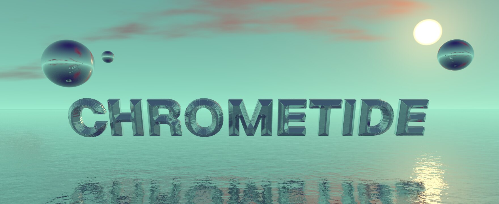
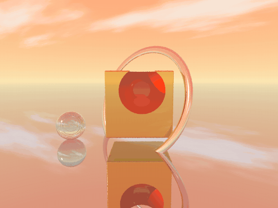
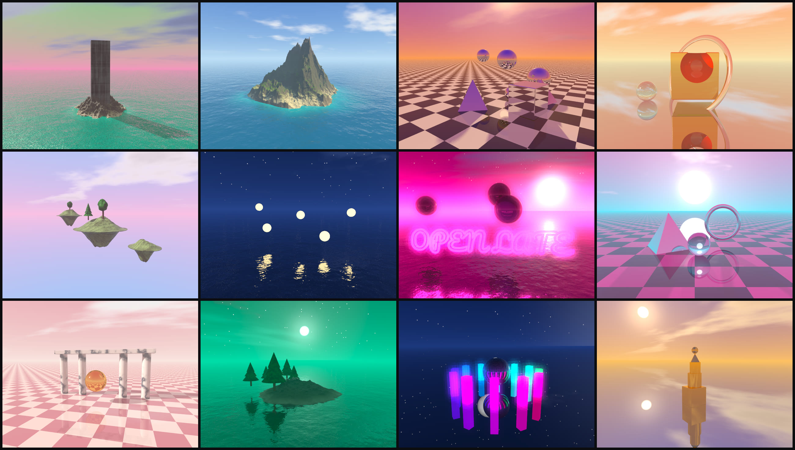
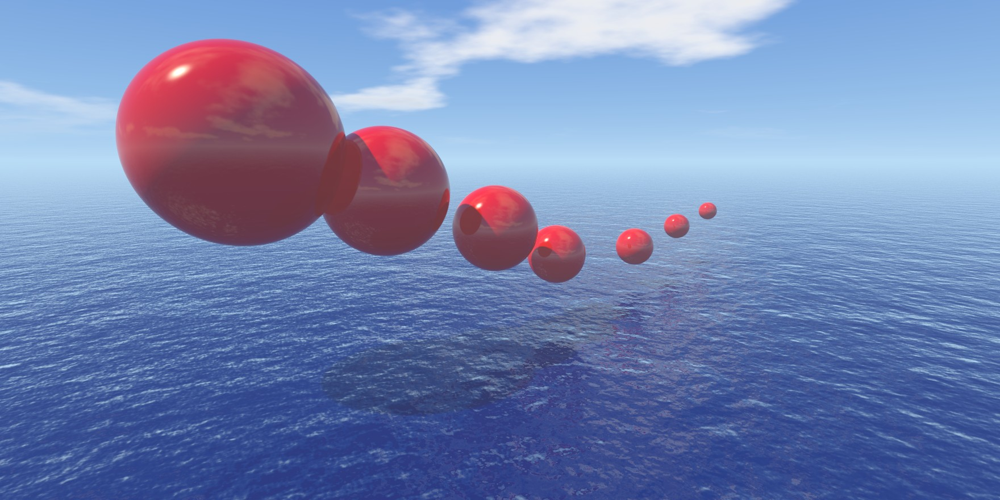
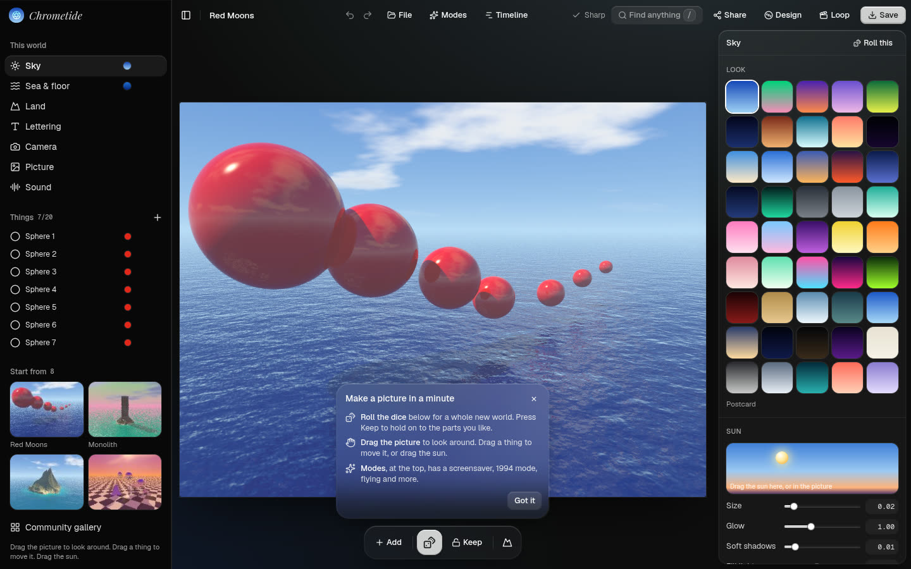
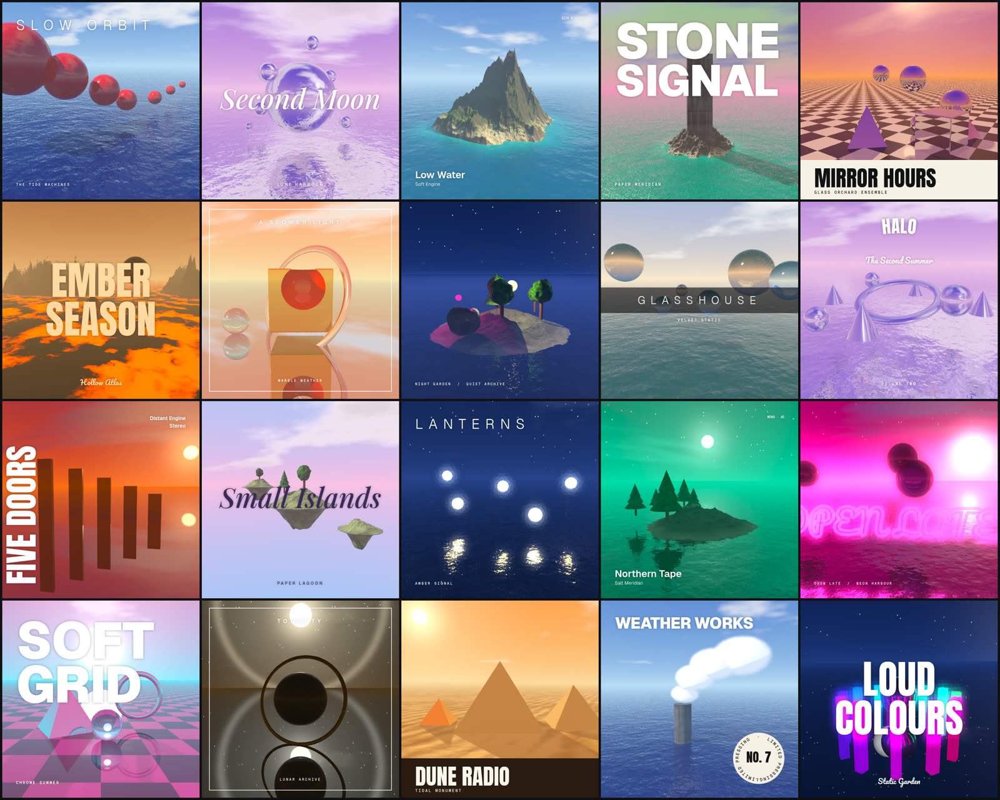
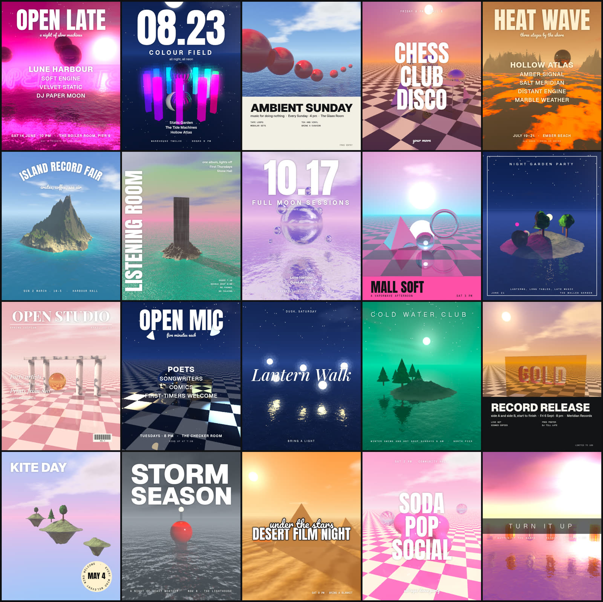
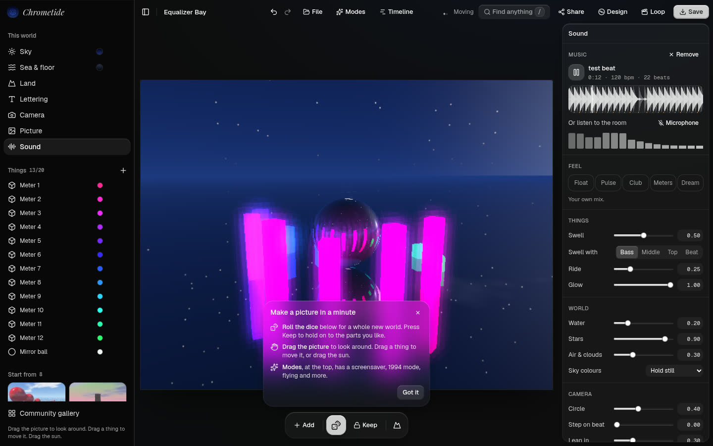

<div align="center">



<p><strong>Chrome spheres over endless water. Hazy two-colour skies. That 2002 ambient-CD look.</strong><br>
A free, open-source world builder that ray traces in your browser. Open a page, make the picture, save it. No install, no account, no AI.</p>

<h3><a href="https://denonmaryland.github.io/chrometide/">▶ Try it now in your browser</a></h3>

<p>
<a href="LICENSE"></a>


<a href="mcp/README.md"></a>
</p>



</div>

<br>

<table align="center">
<tr>
<td align="center" width="33%"><h3>Start</h3>Pick one of 46 ready-made worlds, or roll the dice. Lock the parts you love and roll the rest.</td>
<td align="center" width="33%"><h3>Shape</h3>Drag the sun. Drag things around the picture. Carve shapes out of each other, stand 3D letters in the sea, sculpt the island by hand.</td>
<td align="center" width="33%"><h3>Keep</h3>Save the picture, turn it into an album cover or a flyer, film a loop, or film a whole song as a music video. Share the world as a link.</td>
</tr>
</table>

<br>

<p align="center"></p>

## Why

<p align="center"></p>

In 1994 a program called Bryce let anyone make surreal 3D landscapes, and a generation of album covers,
screensavers and magazine ads came out of it. It no longer runs on current computers. People keep asking
for it back.

This is not a copy. It is a new tool, written from scratch, that goes after the same feeling: a playful
screen, a real ray tracer, and a striking picture in about a minute. Then it goes further than the
original could, because it lives in a browser tab.

## What it does

<p align="center"></p>

- **A real ray tracer, live.** Mirror reflections, glass that bends light, soft shadows, blurry
  reflections, soft focus and bloom. The picture arrives in blocks and sharpens while you watch.
- **46 worlds, 45 skies, 22 materials.** Skies bring their own weather: stars, a moon with phases,
  aurora, fog, rainbows, light rays, a comet.
- **16 shapes that cut and melt.** Spheres, rings, cones, gems, stars, twisted columns, stones, trees, floating
  rocks. Any shape can carve a hole in another, and blobs melt together. A new shape is one small file.
- **Land you can sculpt.** Grown islands and mountain rings with terraces, plateaus and channels. Raise,
  lower, smooth and erode by hand, or turn any picture into land.
- **3D lettering.** Seven typefaces or your own font file. Solid, outline or neon tube. Around a ring, up
  an arch, cut through a gold slab, raised as islands.
- **Dice with locks.** Keep the sky, roll everything else.
- **Every world is a link.** Send it; whoever opens it can remix it.
- **Timeline.** Set keys and every number and colour glides between them.
- **Bring things in, take things out.** Import `.glb` and `.obj` models; export the world as `.glb`,
  `.obj` or a height map.

### Modes

- **1994 mode.** The picture arrives line by line on a glowing 640×480 tube in 256 colours. Film the crawl.
- **A world from any word.** Type your name, your band, your city. The same word grows the same world on every computer.
- **Your GitHub year as an island.** Every day of your year becomes a peak. Save it as a profile banner, or let the
  [profile banner Action](docs/profile-island.md) refresh it every day.
- **Photo to world.** Drop in any photo and the sky, sea, land and colours follow it.
- **Screensaver.** Drifts slowly through worlds forever, and moves to music if any is playing.
- **Fly and look around.** Walk through the world first person, or look all around a 360° picture, with phone tilt
  and VR where the browser offers it.
- **Time-lapse.** Every change you make is remembered; play the making of your world back as a short video.

### Designs

<p align="center"></p>

Turn any world into an **album cover, flyer, poster, postcard, phone wallpaper, banner, ticket or trading
card**. Twenty type layouts, 70 ready-made designs to start from, and mock-ups of a CD case, a cassette
and a vinyl sleeve. Every name on them is a made-up example; change the words and it is yours.

<p align="center"></p>

### Music

<p align="center"></p>

Drop in a song. It is read once, start to finish, so the world knows every beat before it plays. Things
swell with the bass, water ripples, neon glows, stars twinkle, the camera steps on the beat. Watch it
live, or **film the whole song** frame by frame into one video file with the sound in it. The song
never leaves your computer.

### Share it anywhere

- **Embed.** One line puts a live, draggable world on any web page: an iframe, or a `<chrometide-world>` tag.
- **Community gallery.** A page of worlds people made. Offer yours with the "Share a world" form.
- **Render from the terminal.** `node mcp/cli.mjs render "Red Moons" -o moons.png` turns any world or share code
  into a picture without opening the app.

### For agents

There is an [MCP server](mcp/README.md) so an AI agent can build a world, look at the picture and
improve it: 16 tools, running on your own machine.

## Run it

Needs [Node](https://nodejs.org) 22 or newer.

```bash
git clone https://github.com/denonmaryland/chrometide
cd chrometide
npm install
npm run dev        # then open the address it prints
```

`npm run build` makes a plain folder (`dist/`) that any static host can serve. There is no server part.

## How it works

One fragment shader ray traces the whole picture: shapes are signed distance fields (which is what lets
them cut and melt), the land is a fractal height field, and the sea is a plane to the horizon. Each
pass traces one slightly different sample per pixel; passes are averaged, so soft shadows, blur and
smooth edges all come from the same loop. [three.js](https://threejs.org) runs the canvas and the
wireframes. The interface is React with the [Solid Glass](https://github.com/deeplethe/solid-glass)
design system. A world is one small JSON document, which is why it fits in a link.

| Folder | What is in it |
|---|---|
| `src/engine/` | The ray tracer, the world format, the ready-made worlds and skies |
| `src/engine/shapes/` | One file per shape: add yours here |
| `src/features/` | The modes: 1994, word worlds, screensaver, island, photo, fly, time-lapse, embed |
| `src/embed/`, `gallery/` | The embed viewer and the community gallery |
| `src/design/` | Type layouts, mock-ups and the ready-made designs |
| `src/ui/` | The interface |
| `src/audio.ts`, `src/sound.ts` | Reading a song, and moving to it |
| `mcp/` | The MCP server for agents |
| `tools/` | Browser tests and the scripts that render the pictures on this page |

## Add your own

The easiest way to contribute is a **world, a sky or a design**: each is a few lines of data.
[CONTRIBUTING.md](CONTRIBUTING.md) shows how, and how to check your work.

## What is rough

- Tested in Chromium on one Linux laptop. Safari, Firefox and phones need testers.
- A world holds 20 things.
- Imported models with thin parts break up.
- Video is written as MP4 where the browser can encode it, otherwise WebM.

## Credits

Made by [DeNon Maryland](https://github.com/denonmaryland). Every picture on this page was rendered by
the tool. Inspired by Bryce, which is a product and trademark of Daz 3D; this project is not affiliated
with or endorsed by Daz 3D and uses none of its code, artwork, presets or files. Third-party licences
are in [NOTICE.md](NOTICE.md).

MIT licensed.
